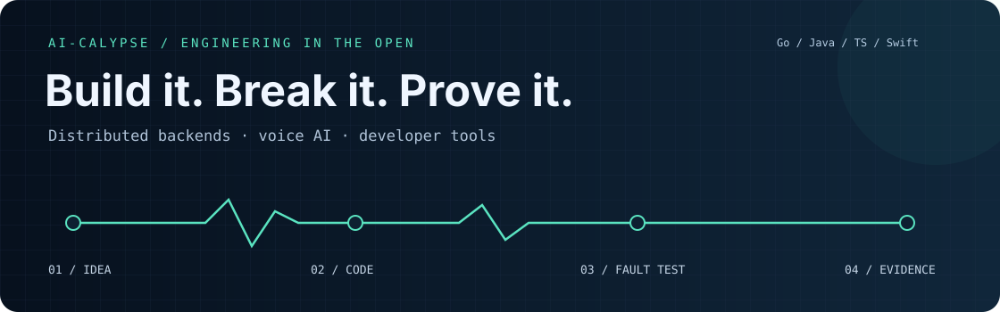

I build backend systems and AI tools, then make their behavior measurable. My projects follow a question
from implementation through concurrency, failures, and the evidence needed to explain what happened.

My strongest themes are **distributed systems, backend reliability, voice interfaces, and developer tooling**.
The code below includes the tradeoffs, experiments, and known limits—not just the happy path.

### Pick a system to inspect

| Project | The engineering question | Start here |
| --- | --- | --- |
| **[ZeroSum Ledger](https://github.com/ai-calypse/zerosum-ledger)** · Java / Spring Boot / PostgreSQL / Kafka | How do you keep an immutable payments ledger correct through duplicate delivery, crashes, and uncertain provider outcomes? | [Architecture decisions](https://github.com/ai-calypse/zerosum-ledger/tree/main/docs/adr) · [Fault experiments](https://github.com/ai-calypse/zerosum-ledger/blob/main/docs/results/s08/ablation-results.md) |
| **[Callstorm](https://github.com/ai-calypse/callstorm)** · Go / WebSocket / Kafka / Kubernetes | Does a voice agent still listen, respond, and complete the task when concurrent callers increase? | [Live dashboard](https://ai-calypse.github.io/callstorm/) · [Measurement design](https://github.com/ai-calypse/callstorm/blob/main/docs/technical-guide.md) |
| **[Avatar Studio](https://github.com/ai-calypse/avatar-studio)** · JavaScript / Web Components / MCP | How can one animation system work across a browser UI, reusable components, exports, and agent tools? | [Source and demos](https://github.com/ai-calypse/avatar-studio) · [Browser and package checks](https://github.com/ai-calypse/avatar-studio/actions/workflows/validate.yml) |
| **[Voice Mac](https://github.com/ai-calypse/voice-mac)** · Swift / TypeScript / Accessibility / Playwright | How do spoken requests become inspectable actions across native apps and the browser? | [Process architecture](https://github.com/ai-calypse/voice-mac/blob/main/docs/architecture.md) · [Offline protocol tests](https://github.com/ai-calypse/voice-mac/tree/main/tests) |

### The details I care about

**Correctness you can re-derive.** Ledger balances come from append-only entries and invariant checks.
Retries, duplicates, and ambiguous outcomes are modeled explicitly.

**Measurements with context.** Callstorm records baseline-relative latency, caller experience, task outcomes,
and harness drift. ZeroSum's performance reports preserve test conditions and limitations.

**Code that can be maintained.** Reproducible setup, focused tests, CI, dependency review, security analysis,
and documented releases make the next change easier to assess. Explore the
[Go checks](https://github.com/ai-calypse/callstorm/actions),
[Java test layers](https://github.com/ai-calypse/zerosum-ledger/actions), and
[macOS/Node checks](https://github.com/ai-calypse/voice-mac/actions).

### A quick tour

*Callstorm's recorded dashboard tour uses a synthetic reference report. The repository separately documents live-agent experiments.*

These are independent portfolio projects at different stages. The repositories state what is implemented,
what was measured, and what is still experimental. Public project questions and collaboration ideas are welcome
through each repository's issues.
